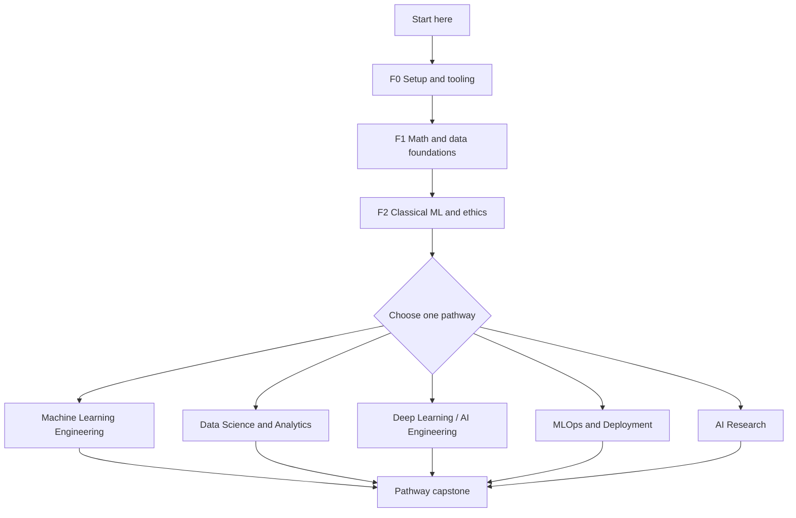

# AI Learning Roadmap

A hands-on AI learning roadmap from basics to advanced, built around real projects rather than passive courses.

> **Attribution and a caveat.** This roadmap was researched and written by an AI agent (Grok Bot) for Hassan (GitHub username: hassanraza-ai). Links and recommendations were checked against official pages in November 2026, but courses, docs, and URLs change. Please verify links and judge resources yourself before you rely on them.

> **Free-first policy.** Every phase and pathway leads with the highest-quality **free** resources: official documentation, open courses, free online books, public papers (for example on [arXiv](https://arxiv.org/)), free video series, and communities. Prefer projects that run on **free compute** — a local CPU, or the free hosted-notebook tiers recommended by the official courses linked below (Kaggle Notebooks in [fast.ai](https://course.fast.ai/), Google Colab in the [Hugging Face LLM Course setup chapter](https://huggingface.co/learn/llm-course/en/chapter0/1)), and free API tiers when an API is needed. Paid materials, certificates, and live cohorts appear only as clearly labeled optional extras, for example **💲 Optional (paid)**, and are never the main recommendation.

## Table of contents

- [Why learn this way](#why-learn-this-way)
- [How to use this roadmap](#how-to-use-this-roadmap)
- [How to choose a pathway](#how-to-choose-a-pathway)
- [Roadmap shape](#roadmap-shape)
- [Overview](#overview)
- [Shared fundamentals](#shared-fundamentals)
  - [F0 — Setup and tooling](#f0--setup-and-tooling)
  - [F1 — Math and data foundations](#f1--math-and-data-foundations)
  - [F2 — Classical ML and ethics](#f2--classical-ml-and-ethics)
- [Pathways](#pathways)
- [Project index](#project-index)
- [Capstone portfolio](#capstone-portfolio)
- [Weekly routine](#weekly-routine)
- [Progress checklist](#progress-checklist)
- [References](#references)

## Why learn this way

Most people who stall in AI study have watched a lot and shipped very little. This roadmap inverts that: **you learn by building**, then you use short, high-quality references to fill the gaps the project exposes.

That is not just a taste preference. Retrieval practice — actively reconstructing what you know, rather than re-watching or re-reading — produces stronger long-term retention than additional study of the same material (Karpicke and Roediger, 2008, [*Science*](https://www.science.org/doi/10.1126/science.1152408)). Deliberate practice — focused work on a skill just beyond your current ability, with feedback, not casual repetition — is the mechanism behind expert performance in Ericsson, Krampe, and Tesch-Römer (1993, [Psychological Review](https://doi.org/10.1037/0033-295X.100.3.363)). The projects below are the practice. Lectures and books are the briefing.

A few rules that follow from that research:

- Finish a small working artifact before you binge the next lecture series.
- After each study block, close the tab and write what you did, what broke, and what you would try next. That is retrieval practice.
- Keep a short self-test (flash questions, a tiny eval set, or a “explain this to a peer” note) and return to it days later.
- Prefer one carefully evaluated project over five half-finished notebooks.

The shared core is the same for everyone: Python, tooling, math and data fluency, classical machine learning, and a first ethics habit. After that the roadmap **branches**. You are not expected to complete every pathway.

## How to use this roadmap

1. Work through **shared fundamentals** (F0–F2) in order. Do not skip the ethics project in F2.
2. Pick **one** pathway using the guide below. Stay on it long enough to finish its phases and capstone.
3. For each phase, skim the free resources, then start the **starter** deliverable the same week. Use the resources while you are stuck, not instead of building.
4. Clear the **exit criteria** before you move on. If you fail a self-check, add a short deliberate-practice loop (one focused drill, then re-test) rather than advancing.
5. Keep every project in a public or private Git repo with a README, how to run it, and a short “what I learned” section.
6. A second pathway is optional, after a capstone. Depth in one path beats a shallow tour of all five.

**Compute.** Default to CPU-sized problems, small public datasets, and small open models. Use free hosted notebooks when a GPU helps (vision, small language models, LoRA). If a stretch goal needs paid GPUs or a paid API, treat it as optional and keep the core deliverable runnable for free.

**Dates and editions.** Several excellent courses are still the 2022–2023 recordings even in 2026 (for example [fast.ai Practical Deep Learning for Coders](https://course.fast.ai/) Part 1, and the [Full Stack LLM Bootcamp](https://fullstackdeeplearning.com/llm-bootcamp/)). Use them for foundations and judgment; re-implement with current libraries when the tooling has moved on.

## How to choose a pathway

| If you want to… | Choose |
| --- | --- |
| Design, train, evaluate, and ship **predictive ML systems** (tabular and classical models, sometimes deep models as components) | [Machine Learning Engineering](pathways/01-machine-learning-engineering.md) |
| Ask sharp questions of data, run trustworthy analyses and experiments, and turn evidence into decisions | [Data Science and Analytics](pathways/02-data-science-and-analytics.md) |
| Build **neural nets, LLM applications, RAG, agents, and fine-tunes** | [Deep Learning / AI Engineering](pathways/03-deep-learning-ai-engineering.md) |
| Make models **reliable in production**: packaging, serving, CI, monitoring, cost, and security | [MLOps and Deployment](pathways/04-mlops-and-deployment.md) |
| Read papers, reproduce results, run careful experiments, and write up findings | [AI Research](pathways/05-ai-research.md) |

You can sample a single project from a neighboring pathway, but keep a primary path so your portfolio has a coherent story.

Ethics, safety, and security are not a separate sixth track here. They are woven into the shared core and into **every** pathway (fairness and documentation in ML and data science; data consent, evals, and misuse in deep learning; threat modeling and rollback in MLOps; dual-use and release decisions in research).

## Roadmap shape

## Overview

| Stage | Focus | Suggested duration | Projects |
| --- | --- | --- | --- |
| **F0** Setup and tooling | Python, Git, the shell, notebooks, reproducible projects | 1–2 weeks | 3 |
| **F1** Math and data foundations | Linear algebra, probability, NumPy, pandas | 3–4 weeks | 3 |
| **F2** Classical ML and ethics | scikit-learn, validation, a first ethics audit | 3–5 weeks | 3 |
| **Pathway 1** [ML Engineering](pathways/01-machine-learning-engineering.md) | Pipelines, evaluation, training systems, services | 12–16 weeks | 12 + capstone |
| **Pathway 2** [Data Science and Analytics](pathways/02-data-science-and-analytics.md) | Analysis, inference, experiments, decision writing | 12–17 weeks | 12 + capstone |
| **Pathway 3** [Deep Learning / AI Engineering](pathways/03-deep-learning-ai-engineering.md) | CNNs, sequence models, transformers, LLMs, RAG, agents, fine-tuning | 20–30 weeks | 18 + capstone |
| **Pathway 4** [MLOps and Deployment](pathways/04-mlops-and-deployment.md) | CI, serving, monitoring, LLMOps, cost, security | 12–17 weeks | 12 + capstone |
| **Pathway 5** [AI Research](pathways/05-ai-research.md) | Paper literacy, reproduction, ablations, open write-ups | 14–21 weeks | 12 + capstone |

At about 8–12 hours per week, expect **two to three months** for the shared core, then **three to seven months** for one pathway and its capstone. The deep-learning pathway is the longest because it spans vision, language, and LLM applications. The catalog contains **80** projects in total; you are meant to complete the **9** shared projects plus **one** pathway (12 or 18 projects) plus **that pathway’s capstone** — 22 or 28 projects, not all 80.

## Shared fundamentals

Complete F0–F2 before branching. Each project has a **starter**, **core**, and **stretch** deliverable. Clear the core and the exit criteria to move on. Stretch is optional extra depth.

### F0 — Setup and tooling

**Goals.** Be able to write Python, use Git, work in a terminal, run notebooks, and keep a reproducible project without fighting your tools.

**Duration.** 1–2 weeks.

**Key concepts.** Virtual environments and package pinning; Git commits, branches, and remotes; the Unix shell; Jupyter (local or hosted); reading official docs; a minimal test and README habit.

**Projects**

| ID | Project | Starter | Core | Stretch |
| --- | --- | --- | --- | --- |
| S01 | Dev environment and first repo | Install Python 3, create a virtual environment, and run a “hello” script. | Public or private Git repo with a README, `.gitignore`, pinned dependencies, and a short setup section another person could follow. | Add a tiny automated test and a pre-commit or lint command. |
| S02 | Shell and notebook lab | Use the shell to list, search, and redirect output on a small text or CSV file. | A notebook that loads the same file, prints summary stats, and saves a plot or table. Document how to run it. | Recreate one notebook step as a command-line script with arguments. |
| S03 | Reproducible analysis template | Copy a clean folder layout (`src/`, `notebooks/`, `data/` or pointers to data, `README.md`). | One command (or a short script) that installs deps and runs tests or a demo. | Add a simple Makefile or `just` file and a license. |

**Free resources (start here)**

- [The Python Tutorial](https://docs.python.org/3/tutorial/index.html) — official language tour, including virtual environments and packages (Chapter 12).
- [Pro Git](https://git-scm.com/book/en/v2) — free official book by Scott Chacon and Ben Straub; work through Getting Started, Git Basics, and Git Branching.
- [The Missing Semester of Your CS Education](https://missing.csail.mit.edu/) — MIT’s free course on the shell, editors, Git, debugging, and related tools (2026 edition is current).
- Hosted notebooks on a free tier, as used by [fast.ai](https://course.fast.ai/) (Kaggle Notebooks) and the [Hugging Face LLM Course](https://huggingface.co/learn/llm-course/en/chapter0/1) (Google Colab), when you do not want to configure a local GPU.

**Exit criteria.** You can create a virtual environment, install a package, commit to Git, and clone your repo on a clean machine (or in a fresh Colab/Kaggle session) and run the README steps without improvising.

### F1 — Math and data foundations

**Goals.** Use linear algebra and probability as *tools* in code: vectors and matrices in NumPy, basic distributions and uncertainty, and tidy tabular analysis in pandas.

**Duration.** 3–4 weeks.

**Key concepts.** Vectors, matrices, matrix multiplication, norms, and projections; derivatives at the level needed for gradient descent later; random variables, expectation, variance, and sampling variability; arrays vs. data frames; joins, group-by, missing data, and a first look at leakage.

**Projects**

| ID | Project | Starter | Core | Stretch |
| --- | --- | --- | --- | --- |
| S04 | Linear algebra in NumPy | Implement vector addition, dot products, and matrix-vector products on tiny examples. | A notebook that visualizes a 2D linear transform, computes a projection, and checks shapes/errors against hand calculations. | Implement a simple least-squares solve and compare it with a library routine. |
| S05 | Probability simulation lab | Simulate coin flips or dice and plot an empirical distribution. | Estimate a mean with a confidence interval via bootstrap or repeated sampling; write in plain language what the interval does and does not mean. | Add a mis-specified model and show how the interval can look “precise” and still be wrong. |
| S06 | Tabular wrangling and EDA | Load a public CSV, list dtypes, missingness, and basic descriptives. | A short EDA report: question, cleaning steps, two or three plots that answer the question, and caveats (selection bias, missingness). | Automate the cleaning into a reusable function with a test on a fixture file. |

**Free resources (start here)**

- [Essence of linear algebra preview](https://www.3blue1brown.com/lessons/eola-preview) — start of 3Blue1Brown’s visual linear algebra series; continue through the series on the same site.
- [Mathematics for Deep Learning](https://www.d2l.ai/) — free appendix in *Dive into Deep Learning* (linear algebra, calculus, probability). Use the PyTorch track later; the math chapters are useful now.
- [NumPy: the absolute basics for beginners](https://numpy.org/doc/stable/user/absolute_beginners.html)
- [pandas getting started](https://pandas.pydata.org/docs/getting_started/index.html)
- [An Introduction to Statistical Learning (ISLP)](https://www.statlearning.com/) — official site for the Python edition; labs at the end of each chapter. Start with the opening chapters on statistical learning and data.

**Exit criteria.** You can compute and explain a matrix-vector product and a sample mean with uncertainty in your own words, and you can clean and summarize a messy table without leaking future information into a “preview” of the target.

### F2 — Classical ML and ethics

**Goals.** Train, validate, and talk honestly about a scikit-learn model. Practice a first ethics pass (documentation, leakage, who is harmed if the model is wrong) before any specialized pathway.

**Duration.** 3–5 weeks.

**Key concepts.** Supervised vs. unsupervised learning; train/validation/test splits and cross-validation; leakage; underfitting and overfitting; linear models, trees and ensembles at a practical level; metrics that match the decision (not only accuracy); calibration as a first look; datasheets/model cards at a lightweight level; fairness slices and representation.

**Projects**

| ID | Project | Starter | Core | Stretch |
| --- | --- | --- | --- | --- |
| S07 | Classification pipeline | Fit a scikit-learn estimator on a built-in or small public dataset with a train/test split. | A `Pipeline` with preprocessing, a baseline (for example a dummy or simple linear model) vs. a stronger model, cross-validation, and a written metric choice. | Nested cross-validation or a calibration plot plus a short “when this model should not be used” section. |
| S08 | Regression with error analysis | Fit a regressor and report RMSE or MAE on a held-out set. | Residual plots, a comparison against a naive baseline (mean predictor), and a discussion of outliers and segment errors. | Quantile errors or a simple heteroscedasticity check; document data-collection limits. |
| S09 | Ethics and documentation audit | Write a one-page data note: source, license, who is in the data, who is missing. | Audit S07 or S08 for leakage, subgroup performance, and foreseeable misuse. Publish a short model card (intended use, limits, metrics by slice). | Propose a concrete mitigation (collect more data, change the threshold, refuse a use case) and show its tradeoff. |

**Free resources (start here)**

- [scikit-learn getting started](https://scikit-learn.org/stable/getting_started.html) and the [User Guide](https://scikit-learn.org/stable/user_guide.html) — official docs; pay special attention to pipelines, cross-validation, and metrics.
- [Machine Learning Crash Course](https://developers.google.com/machine-learning/crash-course) — Google’s free course; includes core models plus production and fairness modules.
- [ISLP](https://www.statlearning.com/) — classification, resampling, linear models, trees, and unsupervised learning, with Python labs.
- [Full Stack Deep Learning 2022](https://fullstackdeeplearning.com/course/2022/) — free lectures; use **Lecture 9: Ethics** and the testing/troubleshooting labs as a production-minded complement (tooling is of its time).
- [Stanford CS229](https://cs229.stanford.edu/) — official Machine Learning course site. Many *current* handouts may require a Stanford login. Prefer ISLP, the Crash Course, and scikit-learn for openly accessible materials; use CS229 when public notes or older public lectures are actually available.

**💲 Optional (paid).** Stanford lists a professional version of some courses with a fee and certificate (for example the professional CS224N option noted on the [CS224N site](https://web.stanford.edu/class/cs224n/)). Skip these unless you specifically want the certificate; the free public materials in this README are enough for F2.

**Exit criteria.** You can explain leakage and why a pipeline belongs *inside* cross-validation; you beat a simple baseline on a held-out set and can say why the metric matches the decision; you have a written model card and at least one subgroup or misuse finding, even if the finding is “I do not have the demographic labels, and that is a limitation.”

## Pathways

After F2, follow **one** file. Each pathway has its own phases, free-first resources, projects of rising difficulty, ethics work, and exit criteria.

| Pathway | File | Best fit | Projects |
| --- | --- | --- | --- |
| 1. Machine Learning Engineering | [pathways/01-machine-learning-engineering.md](pathways/01-machine-learning-engineering.md) | Product and platform ML with classical (and hybrid) models | 12 + capstone |
| 2. Data Science and Analytics | [pathways/02-data-science-and-analytics.md](pathways/02-data-science-and-analytics.md) | Insight, inference, experiments, and decision quality | 12 + capstone |
| 3. Deep Learning / AI Engineering | [pathways/03-deep-learning-ai-engineering.md](pathways/03-deep-learning-ai-engineering.md) | CNNs, RNNs/sequence models, transformers, LLMs, RAG, agents, fine-tuning | 18 + capstone |
| 4. MLOps and Deployment | [pathways/04-mlops-and-deployment.md](pathways/04-mlops-and-deployment.md) | Serving, CI, monitoring, LLMOps, cost, and security | 12 + capstone |
| 5. AI Research | [pathways/05-ai-research.md](pathways/05-ai-research.md) | Papers, reproductions, careful experiments, writing | 12 + capstone |

## Project index

The full catalog is in **[PROJECTS.md](PROJECTS.md)**, with every project ID, title, and home file.

| Block | Count |
| ---: | ---: |
| Shared fundamentals (S01–S09) | 9 |
| Machine Learning Engineering (M01–M12) | 12 |
| Data Science and Analytics (D01–D12) | 12 |
| Deep Learning / AI Engineering (A01–A18) | 18 |
| MLOps and Deployment (O01–O12) | 12 |
| AI Research (R01–R12) | 12 |
| Pathway capstones (C1–C5) | 5 |
| **Total in this repo** | **80** |

Complete **9 + pathway + 1 capstone**. The other pathway projects exist so you can borrow one, switch later, or plan a second path — not so you try to finish all 80.

## Capstone portfolio

Each pathway file ends with a capstone (C1–C5). The capstone should look like a hiring-manager or research-mentor artifact, not a homework dump.

A strong portfolio, after one pathway, is usually:

1. The F2 ethics-aware scikit-learn project (S07–S09).
2. Two or three of your best pathway projects, cleaned up, with READMEs and how to run them on free compute.
3. The pathway capstone, with a short demo (script, notebook, or simple web UI) and a one-page write-up: problem, method, evidence, limits, and ethics.

Publish code on GitHub when you can. If the data cannot be public, publish the code, a synthetic sample, and a careful data description.

## Weekly routine

A sustainable default at 8–12 hours per week:

| Block | Time | What to do |
| --- | --- | --- |
| Build | 50–60% | Work the current project’s starter, then core. |
| Study | 20–25% | Read or watch only what unblocks the project. Take brief notes in your own words. |
| Retrieve | 10–15% | Close the notes. Re-derive one idea, quiz yourself, or explain the last bug out loud. |
| Review | 10% | Revisit last week’s self-check or eval set. Skim your model card or experiment log. |

Take a real off-day. Deliberate practice is tiring if it is working.

## Progress checklist

Copy this into a note or a fork of the repo and check boxes as you go.

**Shared fundamentals**

- [ ] F0 exit criteria (S01–S03)
- [ ] F1 exit criteria (S04–S06)
- [ ] F2 exit criteria (S07–S09), including the ethics audit

**Pathway (pick one)**

- [ ] Machine Learning Engineering, all phase exit criteria, capstone C1
- [ ] Data Science and Analytics, all phase exit criteria, capstone C2
- [ ] Deep Learning / AI Engineering, all phase exit criteria, capstone C3
- [ ] MLOps and Deployment, all phase exit criteria, capstone C4
- [ ] AI Research, all phase exit criteria, capstone C5

**Habit checks**

- [ ] Every shipped project has a README, a way to run it for free, and a short limits/ethics note
- [ ] I can explain my last project’s metric, baseline, and failure modes without looking at notes

## References

Only sources checked while writing this roadmap (November 2026) are listed. If a link fails, search the official site rather than trusting a copy.

**Curricula and books**

- [Practical Deep Learning for Coders](https://course.fast.ai/) and [Part 2: Deep Learning Foundations to Stable Diffusion](https://course.fast.ai/Lessons/part2.html)
- [Neural Networks: Zero to Hero](https://karpathy.ai/zero-to-hero.html) and the [nn-zero-to-hero](https://github.com/karpathy/nn-zero-to-hero) notebooks
- [Dive into Deep Learning](https://www.d2l.ai/)
- [Hugging Face LLM Course](https://huggingface.co/learn/llm-course/en/chapter1/1) ([announcement of the NLP-to-LLM refresh](https://huggingface.co/blog/llm-course); [setup chapter](https://huggingface.co/learn/llm-course/en/chapter0/1); [source](https://github.com/huggingface/course))
- [Hugging Face AI Agents Course](https://huggingface.co/learn/agents-course/en/unit0/introduction)
- [Full Stack Deep Learning courses](https://fullstackdeeplearning.com/course/), [2022 course](https://fullstackdeeplearning.com/course/2022/), and [LLM Bootcamp](https://fullstackdeeplearning.com/llm-bootcamp/) (April 2023 recordings; the site notes that tools have evolved)
- [MIT 6.S191 Introduction to Deep Learning](https://introtodeeplearning.com/index.html)
- [Stanford CS229](https://cs229.stanford.edu/), [CS231n](https://cs231n.stanford.edu/) and [public notes](https://cs231n.github.io/), [CS224N](https://web.stanford.edu/class/cs224n/), [CS25 Transformers United](https://web.stanford.edu/class/cs25/), [CS 329S](https://stanford-cs329s.github.io/)
- [Made With ML — MLOps Course](https://madewithml.com/courses/mlops/)
- [An Introduction to Statistical Learning](https://www.statlearning.com/)
- [Machine Learning Crash Course](https://developers.google.com/machine-learning/crash-course)
- [DeepLearning.AI short course catalog](https://www.deeplearning.ai/short-courses/) — many short courses are free with an account; professional certificates are paid. Use only after the open materials above.
- [Spinning Up in Deep RL](https://spinningup.openai.com/en/latest/)

**Official docs and tooling**

- [Python Tutorial](https://docs.python.org/3/tutorial/index.html), [Pro Git](https://git-scm.com/book/en/v2), [Missing Semester](https://missing.csail.mit.edu/)
- [NumPy beginners guide](https://numpy.org/doc/stable/user/absolute_beginners.html), [pandas getting started](https://pandas.pydata.org/docs/getting_started/index.html)
- [scikit-learn getting started](https://scikit-learn.org/stable/getting_started.html), [User Guide](https://scikit-learn.org/stable/user_guide.html)
- [PyTorch tutorials](https://pytorch.org/tutorials/)
- [FastAPI tutorial](https://fastapi.tiangolo.com/tutorial/)
- [Docker Get started](https://docs.docker.com/get-started/)
- [Hugging Face PEFT](https://huggingface.co/docs/peft/index)
- [3Blue1Brown, Essence of linear algebra preview](https://www.3blue1brown.com/lessons/eola-preview)
- [The Illustrated Transformer](https://jalammar.github.io/illustrated-transformer/) (Jay Alammar)

**Papers and practice essays**

- Vaswani et al., [Attention Is All You Need](https://arxiv.org/abs/1706.03762)
- Lewis et al., [Retrieval-Augmented Generation for Knowledge-Intensive NLP Tasks](https://arxiv.org/abs/2005.11401)
- Hu et al., [LoRA](https://arxiv.org/abs/2106.09685)
- Dettmers et al., [QLoRA](https://arxiv.org/abs/2305.14314)
- Ouyang et al., [Training language models to follow instructions with human feedback](https://arxiv.org/abs/2203.02155) (InstructGPT / RLHF)
- Rafailov et al., [Direct Preference Optimization](https://arxiv.org/abs/2305.18290)
- [Building effective agents](https://www.anthropic.com/research/building-effective-agents) (Anthropic, Dec 2024; the page notes later tooling changes)
- [Demystifying evals for AI agents](https://www.anthropic.com/research/demystifying-evals-for-ai-agents) (Anthropic, Jan 2026)
- Hamel Husain, [Your AI Product Needs Evals](https://hamel.dev/blog/posts/evals/index.html)
- [OWASP GenAI LLM Top 10 2026](https://genai.owasp.org/resource/owasp-genai-llm-top-10-2026/)

**Learning science**

- Karpicke, J. D., and Roediger, H. L., III (2008). The critical importance of retrieval for learning. *Science*. [https://www.science.org/doi/10.1126/science.1152408](https://www.science.org/doi/10.1126/science.1152408)
- Ericsson, K. A., Krampe, R. T., and Tesch-Römer, C. (1993). The role of deliberate practice in the acquisition of expert performance. *Psychological Review*. [https://doi.org/10.1037/0033-295X.100.3.363](https://doi.org/10.1037/0033-295X.100.3.363)

**Notes on access**

- I attempted to open public CS229 lecture-note directories on `cs229.stanford.edu` and received a 403 from this environment; do not assume current CS229 PDFs are openly downloadable.
- I did not include resource URLs I could not open and check. If you want a specific syllabus, assignment, or video playlist that is not linked here, get it from the official course page above.
