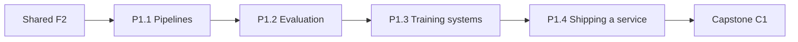

# Pathway 1 — Machine Learning Engineering

**Parent:** [README](../README.md) · **All projects:** [PROJECTS.md](../PROJECTS.md)

Build leak-proof training pipelines, evaluate models against decisions (not just leaderboard scores), run reproducible experiments, and ship a modest service. This path is for people who want to be trusted with **predictive systems** in a product or platform team.

Complete [shared fundamentals](../README.md#shared-fundamentals) first. Free resources and free compute come first in every phase; paid items are labeled **💲 Optional (paid)** and are never required.

**Suggested duration.** 12–16 weeks after the shared core, at 8–12 hours per week.

## P1.1 — Feature engineering and leak-proof pipelines

**Goals.** Put preprocessing inside a scikit-learn `Pipeline`, invent features without leaking the future, and report quality by data slice — not only on the average.

**Duration.** 3–4 weeks.

**Key concepts.** Feature types; imputation and encoding; custom transformers; target leakage and temporal leakage; column transformers; baseline-before-brilliance; missingness as a signal; slice metrics and representation gaps (ethics).

**Projects**

| ID | Project | Starter | Core | Stretch |
| --- | --- | --- | --- | --- |
| M01 | Leak-proof tabular pipeline | Train/test split plus a `Pipeline` with a scaler and a simple model on a public tabular set. | Handle categoricals and missing values inside the pipeline; beat a dummy baseline; document one leakage risk you avoided. | Add a time-based or group-based split if the data supports it. |
| M02 | Custom features and model bake-off | Write one custom transformer (for example, binning or text-length features). | Compare at least two model families with the *same* preprocessing under cross-validation. Keep the search budget tiny so it runs on a CPU. | Nested CV or a short permutation-importance analysis. |
| M03 | Data quality and slice report | List missingness, duplicates, and obvious outliers. | Performance by segment (for example, rare categories or a sensitive proxy). Write what you would tell a product manager if one slice is much worse. | A simple data-schema check that fails the job when columns drift. |

**Free resources (start here)**

- [scikit-learn getting started](https://scikit-learn.org/stable/getting_started.html) and [User Guide](https://scikit-learn.org/stable/user_guide.html) — pipelines, preprocessing, model selection, inspection.
- [ISLP](https://www.statlearning.com/) — resampling, linear models, regularization, trees.
- [Machine Learning Crash Course](https://developers.google.com/machine-learning/crash-course) — numerical/categorical data modules and generalization.
- [Made With ML — MLOps Course](https://madewithml.com/courses/mlops/) — data and testing sections, still useful before you “do DevOps.”

**Exit criteria.** A stranger can rerun M01 or M02 from the README on a CPU. You can point to a pipeline step and say how it would have leaked if it had been fit on the full dataset. You have at least one slice metric in writing.

## P1.2 — Evaluation, uncertainty, and costly mistakes

**Goals.** Choose metrics that match the decision, show calibration and uncertainty, and use time-aware validation when the world is not i.i.d.

**Duration.** 3–4 weeks.

**Key concepts.** Precision, recall, PR vs. ROC, cost-sensitive thresholds; calibration; confidence intervals or bootstrap ranges on metrics; temporal validation; error analysis as a workflow; ethics of asymmetric error (who pays for a false negative?).

**Projects**

| ID | Project | Starter | Core | Stretch |
| --- | --- | --- | --- | --- |
| M04 | Cost-sensitive classifier | Report accuracy *and* a confusion matrix on a held-out set. | Define an explicit cost or utility, pick a threshold on validation data only, and show calibration (reliability curve). | Threshold policies per slice, with a fairness caveat. |
| M05 | Time-aware validation | Sort a dataset with a time column (or a public one that has dates). | Compare a random split to a walk-forward or cutoff split; explain which number you would ship with. | A simple rolling-origin evaluation. |
| M06 | Error-analysis playbook | Collect 20–50 misclassified or high-residual examples. | Tag error types, add one mitigation (features, a rule, or a second model), and re-measure. | A “challenger vs. champion” table you could reuse at work. |

**Free resources (start here)**

- scikit-learn [User Guide](https://scikit-learn.org/stable/user_guide.html) on metrics, calibration, and inspection.
- [Machine Learning Crash Course](https://developers.google.com/machine-learning/crash-course) — classification, thresholding, AUC, and fairness auditing modules.
- [Full Stack Deep Learning 2022](https://fullstackdeeplearning.com/course/2022/) — troubleshooting, testing, and ethics lectures (free; tooling is dated, principles are not).
- [ISLP](https://www.statlearning.com/) — resampling and the limits of formal inference.

**Exit criteria.** You can defend a metric and a threshold in one paragraph. You have compared a random split to a more honest one when time or groups matter. Error analysis changed a decision, not only a slide.

## P1.3 — Training systems and experiment hygiene

**Goals.** Treat training as a system: configs, seeds, logs, budgets, and the ability to resume and reproduce a result.

**Duration.** 3–4 weeks.

**Key concepts.** Experiment tracking (even a CSV plus a config file is enough); seeds and non-determinism; checkpointing; hyperparameter search under a fixed budget; data and code version pins; ethics of wasted compute and irreproducible claims.

**Projects**

| ID | Project | Starter | Core | Stretch |
| --- | --- | --- | --- | --- |
| M07 | Experiment log from scratch | One YAML or JSON config for data path, model, and seed. | Rerun a training job twice with the same seed and compare metrics; store metrics, duration, and git hash in a table. | A tiny CLI (`train.py --config`). |
| M08 | Budgeted hyperparameter search | Grid or random search with a *hard* time or trial cap that finishes on a CPU or free notebook. | Report the search space, the budget, the winner, and a warning about overfitting the validation set. | A learning-curve or data-ablation at two dataset sizes. |
| M09 | Checkpoints and resume | Save a model file and reload it for inference. | Kill and resume a training run (or simulate it) without silently changing the result; document the procedure. | A checksum of data plus model in the README. |

**Free resources (start here)**

- [Made With ML](https://madewithml.com/courses/mlops/) — model, testing, reproducibility, and versioning sections.
- [CS 329S: Machine Learning Systems Design](https://stanford-cs329s.github.io/) — public course notes and slides on design tradeoffs (Winter 2022 materials; still a strong free reference).
- [FSDL 2022](https://fullstackdeeplearning.com/course/2022/) — experiment management, troubleshooting, and data management labs.
- Official library docs for whatever you train with ([scikit-learn](https://scikit-learn.org/stable/user_guide.html) or [PyTorch tutorials](https://pytorch.org/tutorials/) if you pull in a small neural net).

**💲 Optional (paid).** Commercial experiment trackers with paid seats. A local CSV, [Made With ML](https://madewithml.com/courses/mlops/) patterns, or a free tier is enough for this pathway.

**Exit criteria.** You can reproduce a reported number from a config and a commit hash. Search results include the budget, not only the best score.

## P1.4 — Shipping a modest ML service

**Goals.** Expose a model behind a tested API, separate batch from online inference, and log enough to notice silent failure.

**Duration.** 3–4 weeks.

**Key concepts.** Input schemas and validation; serialization; latency vs. throughput; batch jobs; basic observability (request logs, prediction logs); rollback thinking; ethics of dual use, feedback loops, and who is affected when the service is wrong.

**Projects**

| ID | Project | Starter | Core | Stretch |
| --- | --- | --- | --- | --- |
| M10 | Model API | A FastAPI (or similar) endpoint that returns a hard-coded prediction. | Load your real model, validate inputs, write tests for good and bad payloads, and document how to run locally. | A minimal HTML or notebook client. |
| M11 | Batch vs. online | One script that scores a CSV in batch. | Compare batch and request/response paths for the same model (output parity, rough timing). | A simple queue or directory-watcher mock — only if it stays free and local. |
| M12 | Prediction logging and drift stubs | Log inputs and predictions to a JSONL file. | A notebook that summarizes volume, scores, and a crude drift check on one feature. Write a “what we would do if drift spikes” paragraph. | A documented rollback: how to pin a previous model file. |

**Free resources (start here)**

- [FastAPI Tutorial](https://fastapi.tiangolo.com/tutorial/)
- [Docker Get started](https://docs.docker.com/get-started/) — optional even in this phase; useful if you already want a container around M10.
- [FSDL 2022](https://fullstackdeeplearning.com/course/2022/) — deployment and monitoring lectures/labs.
- [Made With ML](https://madewithml.com/courses/mlops/) — production section.
- [CS 329S](https://stanford-cs329s.github.io/) — deployment, monitoring, and the human side of ML projects.

If you later want deeper production work, continue into the [MLOps and Deployment](04-mlops-and-deployment.md) pathway rather than bloating this one.

**Exit criteria.** The API tests pass on a clean machine. You can explain a failure mode (schema change, drift, or a costly error type) and the first mitigation you would ship.

## Ethics in this pathway

Weave the following into READMEs, not as an afterthought: intended use and non-use; slice metrics; leakage as an ethics issue (optimistic numbers harm users); and a clear owner for rollback. Use the Crash Course fairness material and FSDL’s ethics lecture as the free references.

## Capstone C1 — An evaluated ML service

Ship one end-to-end system on free compute: a documented dataset, a leak-proof pipeline, a baseline, a chosen model with honest validation, a model card with slices, and a small API or batch job with tests and prediction logs.

**Starter:** a cleaned repo that reruns training and inference from the README. **Core:** all of the above, plus a two-page write-up a hiring manager can read in ten minutes. **Stretch:** a drift or monitoring notebook and a rollback note. This capstone is project **C1** in [PROJECTS.md](../PROJECTS.md).

**Pathway exit.** C1 is public (or shareable) and reproducible; you can defend metric, split, and ethics limitations without slides.
