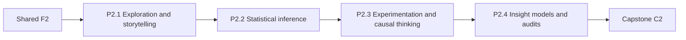

# Pathway 2 — Data Science and Analytics

**Parent:** [README](../README.md) · **All projects:** [PROJECTS.md](../PROJECTS.md)

Learn to ask a sharp question, wrangle evidence without self-deception, quantify uncertainty, and write a recommendation a decision-maker can use. Models are tools on this path, not the product.

Complete [shared fundamentals](../README.md#shared-fundamentals) first. Free resources and free compute come first; paid items are labeled **💲 Optional (paid)** and are never required.

**Suggested duration.** 12–17 weeks after the shared core, at 8–12 hours per week.

## P2.1 — Exploratory analysis and storytelling

**Goals.** Turn a public dataset into a question, a clean table, and a narrative that does not overclaim.

**Duration.** 3–4 weeks.

**Key concepts.** Question-first EDA; tidy data; joins and aggregations; visualization that answers a question; missingness and selection bias; ethics of whose data is missing and how a chart can mislead.

**Projects**

| ID | Project | Starter | Core | Stretch |
| --- | --- | --- | --- | --- |
| D01 | Question-driven deep dive | Pick a public dataset and write three candidate questions; keep one. | A notebook + short report: data provenance, cleaning, descriptives, and two or three plots that actually address the question. | A reproducibility script that rebuilds the figures from raw files. |
| D02 | Tidy data and a style guide | Reshape one messy table (wide/long) and document each column. | A small “data style guide” for the project (naming, units, nulls, keys) and a cleaned output file. | Tests that catch a broken join or a unit mismatch. |
| D03 | Stakeholder one-pager | Outline the audience and the decision the document should inform. | A one-page brief plus a notebook appendix. The brief states findings, confidence, and what you still do not know. | A second version for a different audience (for example, engineers vs. executives) without changing the facts. |

**Free resources (start here)**

- [pandas getting started](https://pandas.pydata.org/docs/getting_started/index.html)
- [NumPy: the absolute basics for beginners](https://numpy.org/doc/stable/user/absolute_beginners.html) — still useful for array-backed plots and simulations.
- [ISLP](https://www.statlearning.com/) — opening chapters on what statistical learning is and is not.
- [The Python Tutorial](https://docs.python.org/3/tutorial/index.html) — refresh any language gaps rather than starting a new course.

**Exit criteria.** A reader can understand the question, the data source, and the limits of the claim from the one-pager alone. The notebook reruns on a free environment.

## P2.2 — Statistical inference

**Goals.** Quantify uncertainty honestly, pre-commit to a test when you can, and avoid p-hacking theater.

**Duration.** 3–4 weeks.

**Key concepts.** Estimators, bias and variance, confidence intervals, hypothesis tests, bootstrap, power at an intuitive level, multiple comparisons, pre-registration; ethics of fishing for significance and of over-precise claims.

**Projects**

| ID | Project | Starter | Core | Stretch |
| --- | --- | --- | --- | --- |
| D04 | Pre-registered comparison | Write a hypothesis and a metric *before* looking at the outcome column (or on a delayed split). | Compute an estimate, an interval, and a test or bootstrap; interpret them in plain language. | A short sensitivity check (different clean rule or outlier policy). |
| D05 | Bootstrap and simulation | Bootstrap a mean or a difference of means. | A simulation that shows when a procedure is well calibrated and when it is not (for example, dependence, or a bad model). | Compare bootstrap intervals to a parametric interval on the same data. |
| D06 | Multiple-testing caution | Compute many correlations or tests on a wide table. | Show how “significant” findings appear under a null (shuffle or simulate); apply a simple correction or a holdout confirmation. | A written policy: what must be confirmed before you would act. |

**Free resources (start here)**

- [ISLP](https://www.statlearning.com/) — statistical learning, resampling, inference-flavored labs, and later chapters you can skim as needed.
- [Dive into Deep Learning](https://www.d2l.ai/) — mathematics appendix on probability, random variables, and statistics (free, executable notebooks).
- [Machine Learning Crash Course](https://developers.google.com/machine-learning/crash-course) — datasets, generalization, and overfitting modules, useful even when you are not training a deep model.

**Exit criteria.** You can explain, without jargon inflation, what your interval covers. You have at least one example where uncorrected multiple tests would have misled you.

## P2.3 — Experimentation and causal thinking

**Goals.** Design or critique an A/B test, spot confounding, and write a ship / iterate / kill memo that a team could use.

**Duration.** 3–5 weeks.

**Key concepts.** Randomization and its limits; metrics and guardrails; sample size intuition; interference and novelty effects; confounding vs. causation; ethics of experiments on people (consent, risk, who is left out of the test).

**Projects**

| ID | Project | Starter | Core | Stretch |
| --- | --- | --- | --- | --- |
| D07 | A/B design and analysis | Define a primary metric, a guardrail, and a unit of randomization on a simulated or public experiment-like dataset. | Analyze a fake or public A/B result: effect size, uncertainty, and a recommendation. | A simple power or simulation study for the sample size you picked. |
| D08 | Confounding case study | Find a striking observational correlation in public data. | Show a confounder (or a plausible one) and how the story changes when you stratify or adjust — without claiming a miracle “causal model.” | A DAG-style sketch in mermaid or a figure, with assumptions listed. |
| D09 | Decision memo | One-page outline: options, evidence, risks. | A memo that recommends ship, iterate, or kill, with ethics risks (harm, exclusion, feedback loops) in the body, not a footnote. | A pre-mortem: how this recommendation could fail in six months. |

**Free resources (start here)**

- [ISLP](https://www.statlearning.com/) — use the book’s emphasis on limits of observational data and on honest validation.
- [Machine Learning Crash Course](https://developers.google.com/machine-learning/crash-course) — production and fairness modules for “what happens after we ship.”
- [FSDL 2022](https://fullstackdeeplearning.com/course/2022/) — project-management and ethics lectures, useful for the memo practice.
- [CS 329S](https://stanford-cs329s.github.io/) — stakeholders, business metrics, privacy, and fairness notes.

**Exit criteria.** You can separate a causal *claim* from a causal *hope*. The memo states what experiment or analysis would change your mind.

## P2.4 — Applied ML for insight (not just accuracy)

**Goals.** Use models as instruments for understanding: interpretable baselines, segments, and a fairness/representation audit of an analysis you already shipped.

**Duration.** 3–4 weeks.

**Key concepts.** Interpretable models vs. post-hoc explanations; segmentation vs. stereotyping; leakage in “insight” features; ethics of profiling; communicating uncertainty to non-specialists.

**Projects**

| ID | Project | Starter | Core | Stretch |
| --- | --- | --- | --- | --- |
| D10 | Interpretable model for a decision | Fit a linear model or a shallow tree on a question from D01–D09. | Explain coefficients or split rules, compare to a black-box only if it earns the complexity, and state where interpretation can lie. | A partial-dependence or simple counterfactual example, carefully caveated. |
| D11 | Segmentation with caveats | Unsupervised grouping or a simple rule-based segment chart. | Name each segment in human language, check stability, and write risks of acting on the labels. | A holdout check that the segments still make sense later in time. |
| D12 | Fairness and representation audit | List who is in the data, who is missing, and which decisions the analysis could influence. | Slice key findings; look for proxies of protected attributes; recommend a mitigation or a refusal to use the analysis in a sensitive context. | A short “datasheet” for the dataset you used. |

**Free resources (start here)**

- [scikit-learn User Guide](https://scikit-learn.org/stable/user_guide.html) — linear models, trees, clustering, inspection.
- [Machine Learning Crash Course](https://developers.google.com/machine-learning/crash-course) — fairness and responsible-engineering material.
- [ISLP](https://www.statlearning.com/) — trees, unsupervised learning, and skepticism about overly flexible fits.
- [FSDL 2022 Lecture 9: Ethics](https://fullstackdeeplearning.com/course/2022/)

**💲 Optional (paid).** Paid dashboard or BI tools. pandas, notebooks, and static reports are enough.

**Exit criteria.** You have one analysis where a model improved *understanding*, not only a score. D12 is written clearly enough to share with a non-ML reader.

## Ethics in this pathway

Pre-register when you can. Do not bury uncertainty. Treat missing groups as a finding. Say no to analyses that would be used to unfairly target people. Put that refusal in the memo when it applies.

## Capstone C2 — A decision-quality analysis

Publish a complete case: question, data provenance, cleaning, inference or experiment, a carefully limited conclusion, and a decision memo. Include an ethics/representation section.

**Starter:** a reproducible notebook and a two-page brief. **Core:** the brief could be handed to a real stakeholder without a live narration. **Stretch:** a simple dashboard or a follow-up experiment design. This is project **C2** in [PROJECTS.md](../PROJECTS.md).

**Pathway exit.** You can defend what would falsify your recommendation, and you can rerun the analysis from the README on free compute.
