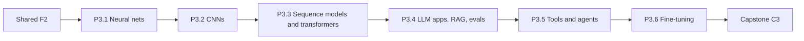

# Pathway 3 — Deep Learning / AI Engineering

**Parent:** [README](../README.md) · **All projects:** [PROJECTS.md](../PROJECTS.md)

Build neural networks in PyTorch, then work up through computer vision, sequence models, transformers, and modern LLM applications: prompting, RAG, evals, tool-using agents, and parameter-efficient fine-tuning. This is the longest pathway on purpose.

Complete [shared fundamentals](../README.md#shared-fundamentals) first. Free resources and free compute come first. Keep models small enough for a laptop CPU or a free Colab/Kaggle GPU. Paid APIs and paid GPUs are **stretch only**.

**Suggested duration.** 20–30 weeks after the shared core, at 8–12 hours per week.

## P3.1 — Neural nets and PyTorch

**Goals.** Understand autodiff and a training loop well enough to debug one, then implement MLPs in PyTorch with honest learning curves.

**Duration.** 3–4 weeks.

**Key concepts.** Tensors; autograd; loss, backpropagation, SGD; train/val curves; initialization and learning rate; overfitting; ethics of cherry-picked curves.

**Projects**

| ID | Project | Starter | Core | Stretch |
| --- | --- | --- | --- | --- |
| A01 | Tiny autograd | A `Value`-style scalar that supports `+`, `*`, and a backward pass on a tiny expression. | Train a small classifier or regressor on a toy 2D dataset with your autograd (or a clearly scoped subset of [micrograd](https://karpathy.ai/zero-to-hero.html) ideas, written by you). | Compare your gradients to PyTorch on the same expression. |
| A02 | MLP in PyTorch | A `nn.Module` trained on a small public or synthetic set. | Learning curves, a baseline (for example logistic regression), and a short note on underfitting vs. overfitting. | A learning-rate finder style sweep at a tiny budget. |
| A03 | Training-dynamics debugger | Plots of loss and a couple of activation or weight histograms. | Break the net on purpose (bad init, huge learning rate) and show the diagnostic that catches it. | Implement a bit of BatchNorm or residual thinking after you have seen it in Karpathy or d2l. |

**Free resources (start here)**

- [Neural Networks: Zero to Hero](https://karpathy.ai/zero-to-hero.html) — start with micrograd; use the [course notebooks](https://github.com/karpathy/nn-zero-to-hero).
- [PyTorch tutorials](https://pytorch.org/tutorials/) — “Learn the Basics” and “Learning PyTorch with Examples.”
- [Dive into Deep Learning](https://www.d2l.ai/) — preliminaries through MLPs (PyTorch track).
- [MIT 6.S191](https://introtodeeplearning.com/index.html) — Lecture 1 and the first software lab; 2026 materials are openly posted.
- [CS231n course notes](https://cs231n.github.io/) — neural nets, backprop, and practical training advice (free, outstanding).
- [Practical Deep Learning for Coders](https://course.fast.ai/) — top-down complement if you want a working stack early; still the 2022 Part 1, and still free.

**Exit criteria.** You can write a training loop without a high-level wrapper and explain a bad curve. A01 or A02 reruns on CPU.

## P3.2 — Computer vision (CNNs)

**Goals.** Build and transfer a convolutional model on a small image task, and document failures and dataset issues.

**Duration.** 3–4 weeks.

**Key concepts.** Convolution, pooling, data augmentation, transfer learning, class imbalance, dataset bias and consent (ethics), model cards for vision.

**Projects**

| ID | Project | Starter | Core | Stretch |
| --- | --- | --- | --- | --- |
| A04 | Small CNN from scratch | A tiny CNN on a small dataset (for example a subset of a standard academic set, or a small set you collect with clear rights). | Train/val accuracy, a baseline (logistic regression on flattened pixels or a tiny MLP), and wall-clock on free compute. | A simple augmentation ablation. |
| A05 | Transfer-learning classifier | Fine-tune a small pretrained model from a standard vision library. | Error slices by class; a gallery of failures; comparison to A04 on the same split. | Grad-CAM or another simple attribution, caveated. |
| A06 | Vision model card | Datasheet: source, license, who appears in the images. | A model card with intended use, failure gallery, and a bias or consent note. | A refusal policy for a sensitive use case. |

**Free resources (start here)**

- [CS231n notes](https://cs231n.github.io/) and the [CS231n course site](https://cs231n.stanford.edu/) — public notes are the priority; live videos may be login-gated, older recordings are often on YouTube via the course page.
- [fast.ai Part 1](https://course.fast.ai/) — practical computer vision and deployment-oriented lessons.
- [d2l.ai](https://www.d2l.ai/) — convolutional networks chapters.
- [MIT 6.S191](https://introtodeeplearning.com/index.html) — vision-related lectures/labs in the current edition.
- [PyTorch transfer-learning tutorial](https://pytorch.org/tutorials/) (listed on the official tutorials index).

**Exit criteria.** You beat a non-conv baseline or you can explain why you did not, with evidence. A06 names license and limits.

## P3.3 — Sequence models and transformers

**Goals.** Implement a character-level language model, then a small GPT, and look inside attention and tokenization.

**Duration.** 4–6 weeks.

**Key concepts.** Language modeling and NLL; embeddings; RNNs at a conceptual level (enough to know what transformers replaced); self-attention; multi-head attention; positional information; BPE/tokenization pitfalls; ethics of training data (copyright, personal data, toxic text).

**Projects**

| ID | Project | Starter | Core | Stretch |
| --- | --- | --- | --- | --- |
| A07 | Character-level LM | A bigram or tiny MLP language model on a small public text (names, tiny Shakespeare, or similar). | Training curve, samples, and a test loss you can reproduce. Follow the spirit of Karpathy’s makemore lectures, in your own code. | A deeper MLP or a WaveNet-style variant if you have the time. |
| A08 | A small GPT | A minimal transformer LM (token or character) that trains on a laptop or free GPU in minutes to a few hours, not days. | Document architecture, tokens, loss, and sample quality against A07. | Context-length or head-count ablation at a tiny scale. |
| A09 | Attention and tokenizer lab | Visualize attention weights on a short prompt, or implement a toy BPE. | A write-up of one tokenizer failure mode (whitespace, numbers, multilingual text, or special tokens) and why it matters. | A short annotated reading of [Attention Is All You Need](https://arxiv.org/abs/1706.03762). |

**Free resources (start here)**

- [Zero to Hero](https://karpathy.ai/zero-to-hero.html) — makemore through “Let’s build GPT” and the tokenizer lecture. (The later GPT-2 reproduction is optional here; see the research pathway if you want that scale.)
- [The Illustrated Transformer](https://jalammar.github.io/illustrated-transformer/)
- Vaswani et al., [Attention Is All You Need](https://arxiv.org/abs/1706.03762)
- [Hugging Face LLM Course](https://huggingface.co/learn/llm-course/en/chapter1/1) — Chapters 1–4 on Transformer models and the Hub (free; designed at about 6–8 hours per chapter).
- [d2l.ai](https://www.d2l.ai/) — attention and transformers chapters.
- [Stanford CS224N](https://web.stanford.edu/class/cs224n/) — official site; the page points to a **free** 2024 public video playlist. Use lecture slides and assignments as they are posted publicly. **💲 Optional (paid):** the professional XCS224N certificate option described on that page.
- [CS25: Transformers United](https://web.stanford.edu/class/cs25/) — free seminar; audit/livestream as announced on the site.

**Exit criteria.** A08 trains and samples from your own code or a clearly cited, understood fork you modified. You can explain one attention head’s role on an example, even if loosely.

## P3.4 — LLM applications: prompting, RAG, and evals

**Goals.** Build a useful LLM app with tests, not vibes. Prefer local or free-tier models. Retrieval should be measurable.

**Duration.** 4–6 weeks.

**Key concepts.** Prompt design and its limits; embeddings and chunking; vector search; RAG failure modes (missed retrieval, uncited answers, stale docs); product evals vs. public benchmarks; ethics of factuality, privacy of the document set, and over-trust.

**Projects**

| ID | Project | Starter | Core | Stretch |
| --- | --- | --- | --- | --- |
| A10 | Prompted app with a test set | A script that calls a *free local or free-tier* model with a fixed prompt template. | A versioned prompt plus at least 20 hand-labeled cases you can rerun (unit-test style). | Systematic prompt changes scored on the same set. |
| A11 | RAG over a doc set | Chunk a public doc set or your own notes (no private third-party data). | Retrieval + generation with citations or source IDs; a retrieval metric (hit rate@k) on a small labeled query set. | A rerank or hybrid-search experiment at a still-tiny scale. |
| A12 | Eval harness | Ten assertions (string checks, JSON schema, or “must cite a source”). | Combine rule-based checks with a documented human review sample. If you use a model-as-judge, calibrate it against your own labels. | Track cost and latency per request, even if the cost is $0 (time is a cost). |

**Free resources (start here)**

- Lewis et al., [Retrieval-Augmented Generation for Knowledge-Intensive NLP Tasks](https://arxiv.org/abs/2005.11401)
- Hugging Face [LLM Course](https://huggingface.co/learn/llm-course/en/chapter1/1) — later chapters on datasets, classic NLP, and demos (Chapter 9).
- [Full Stack LLM Bootcamp](https://fullstackdeeplearning.com/llm-bootcamp/) — free 2023 lectures on prompting, augmented LMs, and launching an app. **Learn the ideas; re-implement with current free tools** (the site itself says tools have evolved).
- Hamel Husain, [Your AI Product Needs Evals](https://hamel.dev/blog/posts/evals/index.html)
- Anthropic, [Demystifying evals for AI agents](https://www.anthropic.com/research/demystifying-evals-for-ai-agents) (useful even before the agents phase)
- [Machine Learning Crash Course](https://developers.google.com/machine-learning/crash-course) — LLM intro module, if you want a gentle second explanation.

Prefer free local open models or officially free playground/API tiers. If a host requires a paid key for the core path, switch models.

**💲 Optional (paid).** Paid model APIs, paid vector-database clouds, and paid eval products. A local index (even numpy or a simple library) and a saved JSON test set are enough.

**Exit criteria.** You can show that a prompt or retrieval change improved a *fixed* eval set. RAG answers include a source, or the system says it does not know.

## P3.5 — Tool use and agents

**Goals.** Add tools carefully. Compare a hard-coded workflow to an agent. Evaluate traces, not only final answers. Follow the “simplest thing that works” advice from practitioners who have shipped agents.

**Duration.** 3–5 weeks.

**Key concepts.** Tool/function calling; workflows vs. agents; state and memory at a basic level; loop limits; observability (transcripts); cost/latency tradeoffs; ethics and security (prompt injection, unsafe tool permissions) — see also the [MLOps pathway](04-mlops-and-deployment.md) and the [OWASP GenAI LLM Top 10 2026](https://genai.owasp.org/resource/owasp-genai-llm-top-10-2026/).

**Projects**

| ID | Project | Starter | Core | Stretch |
| --- | --- | --- | --- | --- |
| A13 | Tool-using loop | One Python tool (calculator, doc lookup, or CSV query) called from a model or a stub. | A small agent or tool loop with a hard step limit, logging of every tool call, and a documented allowed-tool list. | A second tool and a policy for when *not* to call tools. |
| A14 | Workflow vs. agent | Implement the same task as a fixed pipeline. | Compare success, steps, cost/time, and failure modes to A13 on a fixed task set. Write when you would *not* use an agent. | A hybrid: workflow with one agent-like branch. |
| A15 | Trace eval | Save full transcripts. | Grade outcomes *and* a couple of process checks (illegal tool, infinite loop, leaked secrets). | A tiny CI job that runs the eval set on each prompt change. |

**Free resources (start here)**

- Anthropic, [Building effective agents](https://www.anthropic.com/research/building-effective-agents) — start simple; distinguish workflows from agents. (The page notes later tooling changes; the patterns remain the point.)
- Anthropic, [Demystifying evals for AI agents](https://www.anthropic.com/research/demystifying-evals-for-ai-agents)
- [Hugging Face AI Agents Course](https://huggingface.co/learn/agents-course/en/unit0/introduction) — free; fundamentals plus optional work in smolagents and other libraries. Learn the concepts first; do not let a framework hide the prompt and the trace.
- [OWASP GenAI LLM Top 10 2026](https://genai.owasp.org/resource/owasp-genai-llm-top-10-2026/)

**Exit criteria.** You have a logged, limited tool loop and a written argument for or against “full agency” on your task. Prompt-injection or unsafe-tool risk is mentioned in the README.

## P3.6 — Fine-tuning and efficient training

**Goals.** Fine-tune a *small* open model with LoRA or QLoRA on free or almost-free compute, and prove the fine-tune beats a prompting baseline on your eval — or honestly report that it does not.

**Duration.** 3–5 weeks.

**Key concepts.** Supervised fine-tuning; LoRA; quantization and QLoRA; data licensing and quality; catastrophic forgetting at a high level; ethics of data provenance, consent, and releasing adapters.

**Projects**

| ID | Project | Starter | Core | Stretch |
| --- | --- | --- | --- | --- |
| A16 | LoRA on a small model | Run a published PEFT example or notebook on a tiny open model and a tiny public dataset, on a free GPU if needed. | Your own dataset card (source, license, how you filtered) and a training script with a seed and logged loss. | QLoRA if VRAM requires it, following [PEFT](https://huggingface.co/docs/peft/index) docs. |
| A17 | Before/after eval | Reuse an A12-style eval set. | Compare base model, prompted base, and LoRA model on the *same* set. Report wins *and* regressions. | A small human preference pass on 20 examples. |
| A18 | Adapter card | List intended use and license of the base model and the data. | Publish an adapter card: data provenance, eval, known failure modes, and misuse risks. Do not release a model that would clearly enable harm. | A short quantization or latency note. |

**Free resources (start here)**

- [Hugging Face PEFT documentation](https://huggingface.co/docs/peft/index)
- Hu et al., [LoRA: Low-Rank Adaptation of Large Language Models](https://arxiv.org/abs/2106.09685)
- Dettmers et al., [QLoRA: Efficient Finetuning of Quantized LLMs](https://arxiv.org/abs/2305.14314)
- Hugging Face [LLM Course](https://huggingface.co/learn/llm-course/en/chapter1/1) — Chapters 10–12 on fine-tuning and related topics (as described in the course intro).
- Ouyang et al., [InstructGPT](https://arxiv.org/abs/2203.02155) — read for alignment context; you do not need to implement full RLHF here.
- Rafailov et al., [Direct Preference Optimization](https://arxiv.org/abs/2305.18290) — optional reading; a tiny DPO run is stretch only, and only on free compute.
- [MIT 6.S191](https://introtodeeplearning.com/index.html) — the 2026 schedule includes an LLM fine-tune lab.

**💲 Optional (paid).** Hosted fine-tune APIs, Unsloth/commercial stacks if they require a paid plan, and large-GPU rental. Stay on Colab/Kaggle free or local for the core path.

**Exit criteria.** A17 is a real comparison, even if the LoRA loses. A18 states licenses and a misuse boundary.

## Ethics in this pathway

Document data rights at every stage (images, text, fine-tune sets). Evaluate factuality and harmful outputs, not only loss. Limit agent tools. Do not scrape or ship private data. Read OWASP before you expose an LLM to untrusted users.

## Capstone C3 — A evaluated LLM or deep-learning application

Pick one story and go deep: a vision system with a model card, a small GPT plus a write-up, or (recommended in 2026) a RAG or tool-using app with a real eval harness and a safety/limitations section. Prefer free local or free-tier models.

**Starter:** a runnable demo and a fixed test set. **Core:** baseline vs. system table, traces or error gallery, ethics/security note. **Stretch:** a LoRA that earns its keep on the same eval, or a short user study with friends. This is project **C3** in [PROJECTS.md](../PROJECTS.md).

**Pathway exit.** You can explain, end to end, how an input becomes an output, how you know it works, and how it fails.
