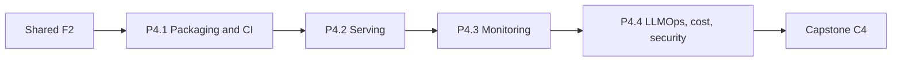

# Pathway 4 — MLOps and Deployment

**Parent:** [README](../README.md) · **All projects:** [PROJECTS.md](../PROJECTS.md)

Turn a model or an LLM app into something you can install, test, deploy, observe, roll back, and afford. The path covers classical ML serving and the newer LLMOps loop (prompt versions, regression evals, cost, and security).

Complete [shared fundamentals](../README.md#shared-fundamentals) first. A small scikit-learn model or a tiny LLM wrapper is enough; you do not need the full deep-learning pathway, though it helps for the LLMOps phase. Free resources and free/local compute come first.

**Suggested duration.** 12–17 weeks after the shared core, at 8–12 hours per week.

## P4.1 — Packaging, testing, and CI

**Goals.** Make the project installable, tested, and checked automatically on every change — including tests that catch data and contract bugs, not only unit-level math.

**Duration.** 3–4 weeks.

**Key concepts.** Packaging; pinning; lint and tests; CI on a free runner; data and model hashes; pre-commit habits; ethics of hidden manual steps (“it works on my laptop”).

**Projects**

| ID | Project | Starter | Core | Stretch |
| --- | --- | --- | --- | --- |
| O01 | Installable package | A package layout with `pyproject.toml` (or equivalent) and an importable function. | Tests for a training or inference helper; a README install path that works in a clean virtualenv. | Typed interfaces and a coverage report you actually look at. |
| O02 | CI on a free tier | A local script that runs lint and tests. | A GitHub Actions (or other *free* CI) workflow that runs on pull requests. Document how a fork can use it. | Cache deps and fail the build on a license or secret-scanning check. |
| O03 | Data and model versioning | Record a SHA-256 (or similar) of the training file and the model artifact. | A documented “what data trained this file” trail; a test that fails if the hash unexpectedly changes. | A lightweight DVC-style or simple object-store demo only if it stays free and simple. |

**Free resources (start here)**

- [Python Tutorial — virtual environments and packages](https://docs.python.org/3/tutorial/index.html) (Chapter 12)
- [The Missing Semester](https://missing.csail.mit.edu/) — especially version control, packaging/shipping, and code quality lectures in the current edition
- [Made With ML](https://madewithml.com/courses/mlops/) — testing, documentation, styling, pre-commit, reproducibility, versioning
- [FSDL 2022](https://fullstackdeeplearning.com/course/2022/) — testing, troubleshooting, and data-management labs

**Exit criteria.** A clean checkout plus the README is enough for tests to pass in CI. Artifacts are hashed and explained.

## P4.2 — Serving and interfaces

**Goals.** Serve a model with a clear contract, a batch path, and a first performance budget. Keep it runnable locally or on a free VM/notebook.

**Duration.** 3–4 weeks.

**Key concepts.** REST or function APIs; schema validation; containerization; batch vs. online; smoke tests; rough SLOs; ethics of exposing a model (auth even on a demo, rate limits, logging of personal data).

**Projects**

| ID | Project | Starter | Core | Stretch |
| --- | --- | --- | --- | --- |
| O04 | Containerized inference app | A [FastAPI](https://fastapi.tiangolo.com/tutorial/) app around a saved model (or a tiny deterministic stub at first). | Dockerfile (see [Docker Get started](https://docs.docker.com/get-started/)), schema tests, and a documented `docker run` or compose path. | A simple web UI (for example a form or a Gradio-style demo) that still runs locally. |
| O05 | Batch prediction job | A CLI that reads a CSV and writes predictions. | Retries, structured logs, and a non-zero exit code on schema failure. | Parity test: batch vs. API on the same rows. |
| O06 | Smoke test and SLO draft | A script that hits the health and predict endpoints. | A written SLO draft (latency, error rate) and a load *sketch* you can run on a laptop (even a short loop). Do not attack any remote system you do not own. | A cheap autoscale or scheduled batch note — design only is fine. |

**Free resources (start here)**

- [FastAPI Tutorial](https://fastapi.tiangolo.com/tutorial/)
- [Docker Get started](https://docs.docker.com/get-started/)
- [FSDL 2022](https://fullstackdeeplearning.com/course/2022/) — deployment lab and lecture
- [CS 329S](https://stanford-cs329s.github.io/)
- [Made With ML](https://madewithml.com/courses/mlops/) — production section

**💲 Optional (paid).** Managed Kubernetes, paid inference endpoints, commercial API gateways. Local Docker plus FastAPI is the core stack here.

**Exit criteria.** Someone else can start the app from the README. You have a smoke test and a written latency/error budget, even if modest.

## P4.3 — Monitoring, drift, and continual learning

**Goals.** Notice silent failure. Log enough to debug. Say in advance when you would retrain or roll back, and who is harmed if you do not.

**Duration.** 3–4 weeks.

**Key concepts.** Prediction and feature logging; data and concept drift (practical checks, not only theory); alerting thresholds; retraining triggers; rollback; shadow mode; ethics of delayed discovery (who was scored in the meantime?).

**Projects**

| ID | Project | Starter | Core | Stretch |
| --- | --- | --- | --- | --- |
| O07 | Offline/online metric dashboard | Save request logs to JSONL or SQLite. | A notebook or simple HTML/CSV dashboard: volume, latency, error rate, and a business or task metric if you have labels. | A daily summary script. |
| O08 | Drift detection | Pick one or two features and a score distribution. | A comparison of “today” vs. a training baseline (PSI, a simple KS-style check, or even a transparent histogram distance). Document false-alarm risk. | Inject synthetic drift and show the detector fires. |
| O09 | Retrain and rollback policy | Write a one-page policy: when to retrain, who approves, how to roll back. | Implement a *manual* rollback (pin a previous artifact) and a dry-run retrain on a slightly newer data slice. | A gated automatic retrain that still requires a human to promote the model. |

**Free resources (start here)**

- [FSDL 2022](https://fullstackdeeplearning.com/course/2022/) — continual learning and model-monitoring labs
- [CS 329S](https://stanford-cs329s.github.io/) — monitoring, shifting data, and stakeholder objectives
- [Made With ML](https://madewithml.com/courses/mlops/)
- [Machine Learning Crash Course](https://developers.google.com/machine-learning/crash-course) — production ML systems module

**Exit criteria.** You can tell a story: “if this plot moves, we do X, and users who were already scored get Y.” Rollback is a practiced motion, not a slogan.

## P4.4 — LLMOps, cost, and security

**Goals.** Treat prompts and tools as production artifacts. Put regression evals in CI. Know what your system costs (money or time) and how it can be abused.

**Duration.** 3–5 weeks.

**Key concepts.** Prompt and model versioning; evals in CI; caching; routing to smaller models; rate limits; secret handling; OWASP-style risks (injection, data leakage, unbounded agency); ethics of logging user text.

**Projects**

| ID | Project | Starter | Core | Stretch |
| --- | --- | --- | --- | --- |
| O10 | Prompt registry and regression evals | Store prompts in files with versions, not only in chat history. | A fixed eval set that runs in CI (or a local pre-push script). A prompt change that worsens the set fails the check. | Trace-level checks as in Anthropic’s [agent eval](https://www.anthropic.com/research/demystifying-evals-for-ai-agents) write-up. |
| O11 | Cost and latency study | Log tokens (or characters) and wall time for a free or local model. | A table: cache vs. no cache, short vs. long context, small vs. slightly larger model — stay on free tiers. Recommend a default. | A budget alert that trips in a test. |
| O12 | Threat model | List assets (data, tools, credentials) and untrusted inputs. | Map at least five risks from the [OWASP GenAI LLM Top 10 2026](https://genai.owasp.org/resource/owasp-genai-llm-top-10-2026/) to *your* app, with a mitigation for each. Include a prompt-injection test if the app takes untrusted text. | A “safe tool” design: least privilege, allow-lists, and human approval for side effects. |

**Free resources (start here)**

- [Full Stack LLM Bootcamp](https://fullstackdeeplearning.com/llm-bootcamp/) — LLMOps lecture; treat 2023 tool names as historical and keep the operational ideas.
- Hamel Husain, [Your AI Product Needs Evals](https://hamel.dev/blog/posts/evals/index.html)
- Anthropic, [Building effective agents](https://www.anthropic.com/research/building-effective-agents) and [Demystifying evals for AI agents](https://www.anthropic.com/research/demystifying-evals-for-ai-agents)
- [OWASP GenAI LLM Top 10 2026](https://genai.owasp.org/resource/owasp-genai-llm-top-10-2026/)
- Hugging Face [LLM Course](https://huggingface.co/learn/llm-course/en/chapter1/1) and [Agents Course](https://huggingface.co/learn/agents-course/en/unit0/introduction) if you need an app to operationalize
- [FastAPI](https://fastapi.tiangolo.com/tutorial/) and [Docker](https://docs.docker.com/get-started/) as needed

**💲 Optional (paid).** Paid observability suites, commercial gateways, and hosted eval platforms. Start with logs, a JSON eval set, and CI on a free runner. Husain’s essay also argues to keep early eval tooling simple.

**Exit criteria.** A prompt regression would be caught before “ship.” You have a written threat model and at least one security test. Cost or latency is measured, not guessed.

## Ethics in this pathway

Production failures are ethics failures when they are silent. Do not log secrets or unnecessary personal text. Do not expose tools that can send mail, move money, or delete data without tight controls. Rollback and incident notes should name affected users, not only uptime.

## Capstone C4 — A monitored, tested deployment

Ship a small model or LLM app with packaging, CI, a container or similarly documented run path, logs, a drift or eval dashboard, a rollback, and an OWASP-inspired threat model. Run it locally or on a free tier.

**Starter:** CI green and a local demo. **Core:** the full loop above plus a one-page operations runbook. **Stretch:** a staged “incident” you inject and then recover from, written up honestly. This is project **C4** in [PROJECTS.md](../PROJECTS.md).

**Pathway exit.** A new contributor can run, test, and roll back the system from the runbook alone.
