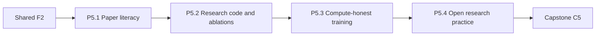

# Pathway 5 — AI Research

**Parent:** [README](../README.md) · **All projects:** [PROJECTS.md](../PROJECTS.md)

Learn to read papers, reproduce a result at a scale you can actually run, ablate it carefully, and write it up so someone else can check you. The goal is research *habits*, not a fake claim of a new state of the art.

Complete [shared fundamentals](../README.md#shared-fundamentals) first. P3.1–P3.3 of the [Deep Learning / AI Engineering](03-deep-learning-ai-engineering.md) pathway are useful preparation if your math-to-PyTorch link still feels thin; you can also start here and dip into those projects as needed. Free papers, open notes, and free compute come first.

**Suggested duration.** 14–21 weeks after the shared core, at 8–12 hours per week.

## P5.1 — Paper literacy and first reproduction

**Goals.** Read a canonical paper slowly, reconstruct its claims, and reproduce a *small* piece of the method or result.

**Duration.** 4–5 weeks.

**Key concepts.** How to read a paper (question, method, evidence, limitations); figures as arguments; related work; what is and is not a contribution; ethics of data, dual use, and over-claiming.

**Projects**

| ID | Project | Starter | Core | Stretch |
| --- | --- | --- | --- | --- |
| R01 | Annotated paper walkthrough | Choose one canonical paper (recommended: [Attention Is All You Need](https://arxiv.org/abs/1706.03762)). | A public note: problem, method, key equations in your own words, claims, and what would falsify them. | A second paper that cites or challenges the first. |
| R02 | Minimal reproduction | Reimplement a single figure, algorithm, or toy result from the paper or from a closely related tutorial-scale setting. | A repo that reruns on free compute, with seeds and a comparison to the paper’s claim (or an explicit statement that you reproduced the *algorithm*, not the original scale). | A side-by-side table of “paper vs. this repo.” |
| R03 | Related-work map | List 8–12 papers or chapters around your topic. | A map (markdown or mermaid) of ideas, plus a critique: what is settled, what is hype, and any ethics or dual-use notes. | A short reading list for a newcomer, with *why* each item is there. |

**Free resources (start here)**

- Vaswani et al., [Attention Is All You Need](https://arxiv.org/abs/1706.03762) and [The Illustrated Transformer](https://jalammar.github.io/illustrated-transformer/)
- [fast.ai Part 2](https://course.fast.ai/Lessons/part2.html) — the course explicitly practices reading and implementing papers (free; more advanced than Part 1).
- [d2l.ai](https://www.d2l.ai/) — use chapters as executable companions to papers (attention, transformers, RL, optimization).
- [CS25: Transformers United](https://web.stanford.edu/class/cs25/) — free research talks; good for surveying a topic after you have read one paper carefully.
- [CS224N](https://web.stanford.edu/class/cs224n/) and [CS231n notes](https://cs231n.github.io/) — free lecture material and (for CS224N) a public video playlist linked from the course site.
- arXiv itself: [https://arxiv.org/](https://arxiv.org/) — prefer official abstracts and PDFs over random blogs when you cite a result.

**Exit criteria.** R01 could be given to a peer who has not read the paper and still make sense. R02 runs from a README on free compute, with an honest scope line.

## P5.2 — From tutorial code to research code

**Goals.** Reimplement a baseline cleanly, run ablations with more than one seed, and treat a negative result as a valid outcome.

**Duration.** 3–5 weeks.

**Key concepts.** Baselines; ablations; seeds and error bars; confounds in experimental design; logging; ethics of p-hacking and of hiding failed runs.

**Projects**

| ID | Project | Starter | Core | Stretch |
| --- | --- | --- | --- | --- |
| R04 | Clean baseline | Reimplement a standard baseline (a small transformer, a classic RL algorithm, or a small vision model) in your own repo. | Match or approach a published *small-scale* number, or document a careful gap. | A config system another researcher could extend. |
| R05 | Ablation study | Pick two factors (for example depth vs. width, or learning rate vs. batch size) at tiny scale. | At least three seeds, a table with variation, and a pre-registered analysis plan written *before* you peek at the full grid. | A plot with error bars and a short “what I would not conclude.” |
| R06 | Negative-result write-up | Choose a hypothesis that might fail (it often will at this scale). | A report that includes failed runs, not only the best one. Explain what you learned. | Submit the write-up to a blog, lab notebook, or informal workshop — only if you are proud of the honesty, not the headline. |

**Free resources (start here)**

- [PyTorch tutorials](https://pytorch.org/tutorials/)
- [Zero to Hero](https://karpathy.ai/zero-to-hero.html) and [nn-zero-to-hero](https://github.com/karpathy/nn-zero-to-hero) — especially the later lectures on diagnostics and (optionally) the GPT-2 lecture as a *reading*, not a must-run at full scale.
- [Spinning Up in Deep RL](https://spinningup.openai.com/en/latest/) — if you lean toward RL: key concepts, algorithms, and the “Spinning Up as a Deep RL Researcher” guide.
- [d2l.ai](https://www.d2l.ai/) — optimization, attention, and RL chapters as needed.
- [MIT 6.S191](https://introtodeeplearning.com/index.html)

**Exit criteria.** You can show a table with seeds. A failed hypothesis is written up without being quietly dropped.

## P5.3 — Training at the edge of *your* compute

**Goals.** Learn scaling behavior and training-loop efficiency on hardware you actually have (CPU or a free GPU). Do not pretend you trained a frontier model.

**Duration.** 3–5 weeks.

**Key concepts.** Scaling along data, steps, and model size at toy scale; mixed precision and compilation when available; profiling; throughput vs. quality; ethics of energy use and of inflated compute claims.

**Projects**

| ID | Project | Starter | Core | Stretch |
| --- | --- | --- | --- | --- |
| R07 | Tiny scaling law | Train the same architecture at two or three small sizes or data budgets. | A plot of loss vs. compute or tokens, with a written limit (“this is a toy trend”). | Compare two families (for example, width vs. depth) at a fixed budget. |
| R08 | Faster training loop | Profile a slow loop (data loading or a naive Python bottleneck). | One measured speedup (batching, fewer copies, mixed precision, or `torch.compile` if it works in your free environment). Report before/after. | A short “what I refused to optimize” list. |
| R09 | Public training log | Keep a diary of runs (config, git hash, hardware, time, outcome). | Publish the log and a reproducibility README so a stranger can match a reported curve on similar free hardware. | A plot gallery in the repo, generated by a script, not by hand. |

**Free resources (start here)**

- [PyTorch tutorials](https://pytorch.org/tutorials/) — performance and profiling-related tutorials on the official index.
- [fast.ai Part 2](https://course.fast.ai/Lessons/part2.html) — mixed precision, training practice, and implementation from scratch (free; heavy, and worth it if you have finished Part 1 or equivalent).
- [d2l.ai](https://www.d2l.ai/) — performance and optimization chapters in the current book.
- [MIT 6.S191](https://introtodeeplearning.com/index.html) — the 2026 edition includes a lecture on massively parallel training; take ideas, then scale them *down* to your hardware.
- Karpathy’s later Zero to Hero lectures, including the GPT-2 reproduction discussion on [the official course page](https://karpathy.ai/zero-to-hero.html). A full 124M reproduction may exceed free compute; a smaller clone with the same discipline is a valid core.

**💲 Optional (paid).** Cloud GPU rental for a stretch run. If you use it, still keep a free-compute baseline so others can reproduce the *method*.

**Exit criteria.** You report hardware, wall time, and tokens or steps. Speedups are measured. Claims match the scale you actually ran.

## P5.4 — Open research practice

**Goals.** Work like a careful junior researcher: a scoped literature review, a pre-registered small question, and a public write-up with open code.

**Duration.** 4–6 weeks.

**Key concepts.** Novelty vs. incremental work; pre-registration of a small question; statistical humility; citation practice; release ethics (weights, data, dual use); how to ask for feedback.

**Projects**

| ID | Project | Starter | Core | Stretch |
| --- | --- | --- | --- | --- |
| R10 | Subfield review | Pick a narrow topic (for example toy interpretability, small-scale RAG evals, DPO at tiny scale, or a single RL algorithm). | A 4–8 page review with citations to official papers and a “open questions I could actually touch” section. | A timeline figure of the idea. |
| R11 | Pre-registered mini-experiment | Write the question, metrics, and stop rule *first*, in the repo. | Run the experiment; report according to the plan; label any exploratory extras as post hoc. | A reviewer-style critique of your own paper. |
| R12 | Public report and code | A clean repo with license, data notes, and a draft PDF or markdown paper. | A complete related-work, method, results, limitations, and ethics/release section. Invite critique. | A blog version or a talk recording — still secondary to the paper-like write-up. |

**Free resources (start here)**

- Papers: [LoRA](https://arxiv.org/abs/2106.09685), [QLoRA](https://arxiv.org/abs/2305.14314), [RAG](https://arxiv.org/abs/2005.11401), [InstructGPT](https://arxiv.org/abs/2203.02155), [DPO](https://arxiv.org/abs/2305.18290) — read what your subfield actually needs, not all of them by default.
- [Spinning Up](https://spinningup.openai.com/en/latest/) — “Spinning Up as a Deep RL Researcher” and the key-papers list, if you work on RL.
- [CS25](https://web.stanford.edu/class/cs25/) — current talks as a way to hear how researchers frame open problems.
- [CS224N](https://web.stanford.edu/class/cs224n/) — the public site discusses social and broader impacts; use that lens in R12.
- [Building effective agents](https://www.anthropic.com/research/building-effective-agents) or eval essays only if your research question is about agents or evaluation.

**Exit criteria.** R11’s plan is dated before the final runs. R12 has limitations and an ethics/release paragraph that a supervisor would not immediately reject.

## Ethics in this pathway

Cite the paper you actually read. Do not scrape or release sensitive data. State dual-use risks (for example, a jailbreak method or a copyrighted-data recipe) and withhold or narrow a release when the risk is real. Negative results are more ethical than a single lucky seed.

## Capstone C5 — A small, honest research contribution

Deliver a short paper-like report and a reproduction package: one clear question, related work, a baseline, an experiment at free or honestly disclosed compute, seeds, and a limitations/ethics section. Novelty can be tiny (a careful negative result, a cleaner reproduction, or a small extension).

**Starter:** a draft with a working repo. **Core:** a report you would be willing to send a researcher for informal feedback. **Stretch:** a public post or a workshop-style appendix with extra ablations. This is project **C5** in [PROJECTS.md](../PROJECTS.md).

**Pathway exit.** Another person can rerun the main table, or you have documented exactly why they cannot (hardware) and provided a smaller surrogate.
